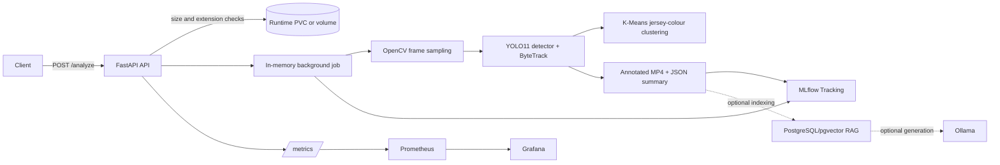
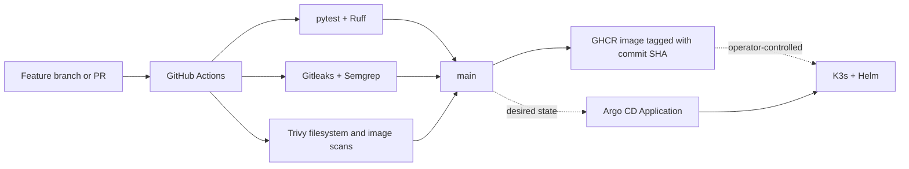
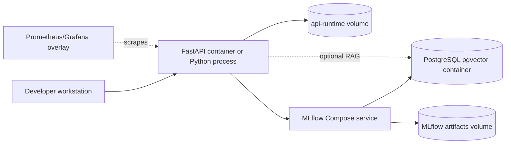
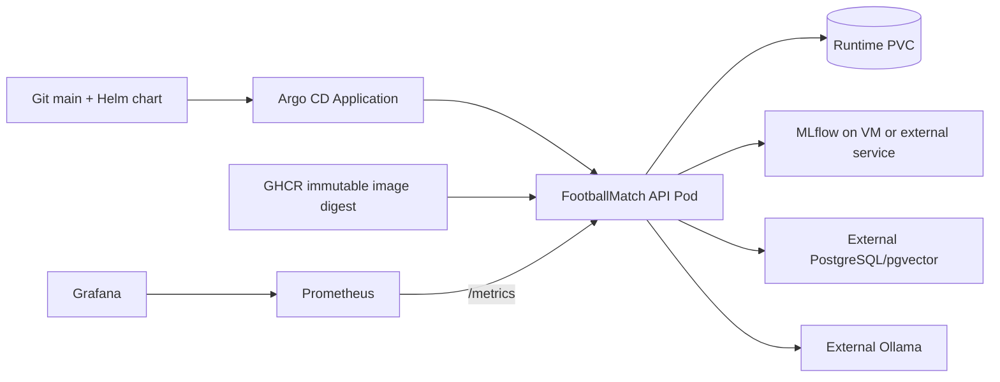
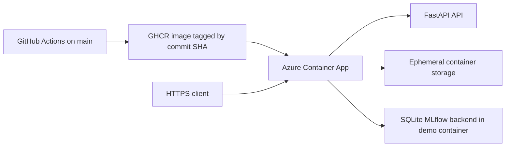

# FootballMatch AI Platform Architecture

## Scope and evidence level

FootballMatch is a local-first computer-vision and MLOps platform. This document
describes the implementation visible in this repository. Statements labelled
**repository evidence** come from committed code, tests, CI configuration, or
validation records. A historical validation record is not treated as proof that
the environment is still running today.

## End-to-end application flow

1. `POST /analyze` accepts a multipart video and validates its extension and
   configured byte limit.
2. The upload is written below a UUID job directory. The API returns `202` and
   starts a daemon thread; the job index is process-local.
3. The pipeline reads metadata with OpenCV, creates a deterministic sampling
   plan, and processes sampled frames.
4. `YoloDetector.track()` calls Ultralytics with `bytetrack.yaml` and persistent
   tracking. Only `person` and `sports ball` detections are retained.
5. The pipeline writes an annotated MP4, counts detections and unique tracks,
   extracts jersey colour features, and applies deterministic two-cluster
   K-Means. Team labels are colour clusters, not verified team identities.
6. The summary is stored as JSON and tracked in MLflow with parameters, metrics,
   tags, input hash, and output artifacts.
7. Optional RAG indexing stores analysis summaries in PostgreSQL/pgvector and
   can query Ollama. It is not required for the core video path.

## API and runtime boundaries

| Endpoint | Behaviour | Boundary | Evidence |
| --- | --- | --- | --- |
| `/health` | Process health | No dependency check | `src/footballmatch_api/main.py` |
| `/ready` | Configuration readiness | Does not prove MLflow, database, or model availability | `src/footballmatch_api/main.py` |
| `/analyze` | Accepts a video and creates a job | Extension and size checks only | `src/footballmatch_api/services/analysis_jobs.py` |
| `/jobs/{id}` | Returns job state and summary | State is local to one process | `src/footballmatch_api/main.py` |
| `/matches/{id}` | Returns completed summary | Returns `409` until complete | `src/footballmatch_api/main.py` |
| `/metrics` | Prometheus exposition | No authentication in the application | `src/footballmatch_api/main.py` |
| `/rag/ask` | Optional grounded answer | Requires PostgreSQL and Ollama | `src/footballmatch_api/rag/api.py` |

The public job response deliberately omits server-local input and output paths.
Internal failures are logged with a job identifier while the client receives a
generic failure message. The API has no authentication or authorization layer;
the documented operating boundary is a trusted local network with TLS and
authentication required before external exposure.

## MLflow Tracking and Registry

The normal detector path loads `yolo11n.pt` lazily and runs CPU inference. When a
tracking URI is configured, the service records runs in the configured MLflow
server; otherwise it uses a local SQLite backend under `mlruns/`.

The registry scripts implement a controlled candidate flow:

1. `register_detector_model.py` packages a YOLO checkpoint as an MLflow PyFunc
   model and assigns the `candidate` alias.
2. `test_registered_detector.py` loads the candidate and requires a configured
   minimum detection count before tagging the version with `smoke_test=passed`.
3. `promote_detector_model.py` refuses promotion unless that smoke-test tag is
   present, then assigns the `champion` alias.
4. The API can load `models:/FootballMatchYOLODetector@champion` when configured.

The smoke gate proves loadability and inference execution. It does not establish
precision, recall, tracking identity quality, or team-classification accuracy.
A labelled benchmark is still required for a quality-sensitive deployment.

## Delivery paths

The workflow publishes only on a successful push to `main`; pull requests build
and scan without publishing. The GitOps manifest points Argo CD at the Helm chart
on `main` and references an immutable image digest. Argo CD has automated sync and
self-healing enabled, while pruning is disabled. No cloud deployment is performed
by the pull-request workflow.

## Environment topology

### Development local

This path is defined by `compose.yaml`, `Dockerfile`, and the optional
`compose.observability.yaml`. PostgreSQL is required by the Compose MLflow
backend. The API uses the Compose DNS name `mlflow`; the RAG extension uses the
database credentials supplied through the local ignored `.env` when enabled.
The repository contains configuration and historical local validation records;
this session did not start Docker because Docker is not available on the host.

### Kubernetes/K3s

The Helm chart deploys the API, Service, ConfigMap, optional existing Secret
reference, probes, resource limits, non-root security settings, and a runtime
PVC. It does not deploy PostgreSQL, MLflow, Ollama, Prometheus, or Grafana. The
Argo CD manifest supplies environment-specific endpoints and an image digest.
The documented K3s validation is historical: it recorded a healthy Pod, PVC,
Helm release, MLflow connectivity, and an inference run. No K3s rollout or
rollback was executed in this session.

### Azure Container Apps

The Azure path is independent of Helm and Argo CD. The repository contains no
Azure deployment script or Bicep/Terraform resource definition; it contains a
manual validation record and `az containerapp show` inspection commands. The
record describes a historical public CPU demo using a GHCR commit-SHA image,
scale-to-zero, ephemeral storage, and SQLite MLflow metadata. It explicitly
states that PostgreSQL/pgvector and Ollama were absent from that demo. The
repository provides no evidence that Prometheus or Grafana monitored the Azure
Container App; only the API `/metrics` endpoint was checked.

### Local Python

The project requires Python 3.11 or newer and the repository examples use Python
3.12. The API, tests, and CLI can run without a GPU. Model weights are downloaded
by Ultralytics on first use and should remain outside Git.

### Docker Compose

`compose.yaml` runs PostgreSQL with pgvector, MLflow, and the API. PostgreSQL is
bound to loopback by default, MLflow exposes port 5000, and the API exposes port
8000. Named volumes hold database data, MLflow artifacts, and API runtime files.
The observability overlay adds Prometheus and Grafana with loopback-only ports and
bind-mounted persistence.

### K3s/Kubernetes

The Helm chart deploys the API, a ClusterIP Service, probes, a local-path runtime
PVC, resource requests/limits, and a non-root/seccomp runtime. PostgreSQL, MLflow,
and Ollama are external to this chart in the documented single-node topology.
Credentials are referenced from an existing Kubernetes Secret; they are not Helm
values. The optional ServiceMonitor and Grafana dashboard ConfigMap are disabled
by default because Prometheus Operator is not assumed.

### Azure Container Apps

The repository contains a historical validation record for a public CPU demo using
an immutable GHCR image and scale-to-zero configuration. That record is evidence of
the documented deployment at that time, not a claim that the endpoint is currently
reachable or that the Kubernetes manifests run in Azure. Production would require
durable storage, authentication, queue-backed workers, and a managed tracking
database.

## Deployment evidence matrix

| Item | Local Compose | K3s/Kubernetes | Azure Container Apps |
| --- | --- | --- | --- |
| API packaging | Dockerfile and Compose build | Same image through GHCR | Same image through GHCR |
| MLflow | Compose service with PostgreSQL backend | External service on documented VM path | Historical SQLite in demo container |
| PostgreSQL/pgvector | Compose service | External dependency when RAG is enabled | Not present in recorded demo |
| Helm/Argo CD | Not used | Helm chart and Argo Application configured | Not used |
| Prometheus/Grafana | Optional Compose overlay | External/lightweight monitoring path | Not evidenced; `/metrics` was checked |
| Persistent storage | Named Docker volumes | Runtime PVC | Ephemeral container storage |
| Current runtime validation | Not rerun in this session | Not rerun in this session | Historical record only |
| Rollback evidence | Not captured | Historical recovery note; controlled rollback remains pending | Not captured |

## Observability

The application exports request counters and latency histograms plus video-job,
frame, detection, inference, and optional RAG metrics. Prometheus scrapes the API
through the Compose overlay. Grafana provisions a dashboard for HTTP health,
processing volume, inference duration, detections, and RAG timing. Metrics are
operational signals, not model-quality measurements.

## Security and reliability posture

- Containers run as a non-root user with dropped capabilities and a default seccomp
  profile in the Helm chart.
- Uploads have an extension allow-list and byte limit; content validation and
  malware scanning remain future work.
- `.env`, media, weights, MLflow data, and runtime artifacts are ignored.
- Gitleaks, Semgrep, Ruff, pytest, and Trivy are part of CI.
- The API has no built-in authentication, rate limiting, durable job queue, or
  multi-replica coordination.
- A process restart loses the in-memory job index even if the PVC still contains
  output files.
- `strategy: Recreate` and one replica avoid concurrent detector state in the
  current design but do not provide high availability.

## Validation boundary

The repository has unit and contract tests for the API, jobs, video sampling,
detector adapters, clustering, MLflow tracking, registry gates, RAG, and health
endpoints. CI also validates packaging and static security controls. Runtime
validation of Compose, K3s, Prometheus/Grafana, Argo CD reconciliation, rollback,
and current Azure availability must be reported separately from static CI results.

