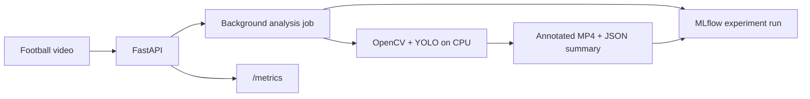

# FootballMatch AI Platform

A local MLOps platform that turns football videos into annotated footage, structured
analysis, and traceable MLflow experiments.

[](https://github.com/farah-ben-harb/footballmatch-ai-platform-mlops/actions/workflows/ci.yml)

[Architecture](#architecture) · [Quick start](#quick-start) · [API](#api-reference) ·
[Deployment](#deployment) · [Validation](#validation-and-security)

## Overview

FootballMatch AI Platform uses football-video analysis to demonstrate how to serve,
track, test, package, and observe an AI workload. A pretrained detector keeps the
focus on MLOps and platform engineering rather than model research.

The MVP runs on a CPU, uses local storage, and requires no paid cloud service or AI API.
The repository includes the application, automated CI, container packaging, and
versioned Kubernetes, monitoring, and GitOps deployment configurations.

## Key capabilities

- **Video analysis:** OpenCV frame sampling and YOLO11n detection of people and sports balls.
- **Asynchronous API:** video uploads, background jobs, status polling, and structured results with FastAPI.
- **Experiment tracking:** MLflow parameters, metrics, tags, annotated videos, and model/run metadata.
- **ML component:** a standalone scikit-learn K-Means component for jersey-colour clustering.
- **Observability:** Prometheus metrics for requests, latency, jobs, frames, detections, and inference duration.
- **Delivery automation:** tests, linting, security checks, Docker builds, and GHCR image publication.

## Architecture



Locally, MLflow stores runs in `mlruns/`. The Compose configuration uses PostgreSQL
for MLflow metadata and a separate volume for artifacts. API job state is process-local.

The platform configuration adds a Helm chart for the API, a Prometheus ServiceMonitor,
a Grafana dashboard definition, and an Argo CD Application manifest.

## Quick start

Prerequisites: Git, Python 3.10, and FFmpeg/FFprobe on `PATH`. The Windows examples
use PowerShell 7 and the Python launcher (`py`). No GPU is required. The first
inference downloads `yolo11n.pt`; later runs can reuse the cached weights.

### 1. Get the project

```bash
git clone --branch main https://github.com/farah-ben-harb/footballmatch-ai-platform-mlops.git football-match-ai-platform
cd football-match-ai-platform
```

### 2. Install and start the API

Windows / PowerShell 7:

```powershell
py -3.10 -m venv .venv
.\.venv\Scripts\python.exe -m pip install -e ".[dev]"
$env:FOOTBALLMATCH_RUNTIME_DIRECTORY = "artifacts/runtime"
.\.venv\Scripts\python.exe -m uvicorn footballmatch_api.main:app --host 127.0.0.1 --port 8000
```

<details>
<summary>Linux equivalent</summary>

```bash
python3.10 -m venv .venv
.venv/bin/python -m pip install -e ".[dev]"
export FOOTBALLMATCH_RUNTIME_DIRECTORY=artifacts/runtime
.venv/bin/python -m uvicorn footballmatch_api.main:app --host 127.0.0.1 --port 8000
```

</details>

Keep this terminal running. Open the [interactive API documentation](http://127.0.0.1:8000/docs)
or check [process health](http://127.0.0.1:8000/health), which returns `{"status":"ok"}`.
The runtime setting above keeps uploads and outputs inside the Git-ignored `artifacts/` directory.

### 3. Analyze a video

Use a short football clip you have permission to process. Place it at
`data/raw/match.mp4` after creating the directory. Videos are not bundled with the repository.

In a second PowerShell 7 terminal, from the repository root:

```powershell
$baseUrl = "http://127.0.0.1:8000"
$job = Invoke-RestMethod -Method Post -Uri "$baseUrl/analyze" -Form @{ file = Get-Item "data/raw/match.mp4" }
$job
```

The API returns HTTP `202` with a job `id` and a `status_url`. Check its progress:

```powershell
Invoke-RestMethod -Uri "$baseUrl/jobs/$($job.id)"
```

Repeat the status request until the job is `completed` or `failed`. A failed job
includes an `error` field. Once completed, retrieve the analysis:

```powershell
Invoke-RestMethod -Uri "$baseUrl/matches/$($job.id)" | ConvertTo-Json -Depth 6
```

The response contains the detection summary, frame count, timing measurements,
output path, and `mlflow_run_id`. With the runtime setting above, files are written to:

```text
artifacts/runtime/jobs/<job-id>/annotated.mp4
artifacts/runtime/jobs/<job-id>/summary.json
```

Linux users can upload and inspect results through the same interactive API documentation.

### 4. Inspect experiments

In another terminal at the repository root, start the local MLflow interface:

```powershell
.\.venv\Scripts\python.exe -m mlflow ui --backend-store-uri ./mlruns --host 127.0.0.1 --port 5000
```

Open [MLflow](http://127.0.0.1:5000) and select `football-video-analysis` to compare
run parameters, performance metrics, detection counts, and output artifacts.
On Linux, use `.venv/bin/python` in place of the Windows interpreter path.

## API reference

| Method | Endpoint | Purpose |
| --- | --- | --- |
| `GET` | `/health` | Process health |
| `GET` | `/ready` | API readiness response and environment |
| `POST` | `/analyze` | Upload a video and receive a job ID |
| `GET` | `/jobs/{id}` | Job status, error, and available result |
| `GET` | `/matches/{id}` | Completed analysis; returns `409` while incomplete |
| `GET` | `/metrics` | Prometheus metrics |

Supported upload extensions: `.mp4`, `.mov`, `.avi`, `.mkv`, and `.webm`.
The default upload limit is 100 MB (100,000,000 bytes). Readiness describes the API;
the detector loads lazily on the first analysis job.

For batch analysis without running the API:

```powershell
.\.venv\Scripts\python.exe scripts/analyze_video.py --input data/raw/match.mp4 --sample-fps 5 --confidence 0.25
```

This produces `artifacts/annotated-match.mp4`, `artifacts/analysis-summary.json`, and
an MLflow run. Linux users can use the same arguments with `.venv/bin/python` and
`scripts/analyze_video.py`.

## Deployment

| Asset | Scope |
| --- | --- |
| [Dockerfile](Dockerfile) | API image with FFmpeg and a non-root runtime user |
| [Docker Compose](compose.yaml) | API, MLflow, PostgreSQL, and persistent volumes |
| [Helm chart](helm/footballmatch-ai-platform) | API Deployment, Service, probes, resources, storage, and monitoring configuration |
| [Grafana dashboard](helm/footballmatch-ai-platform/dashboards/footballmatch-api.json) | Dashboard definition for application metrics |
| [Argo CD Application](gitops/argocd/footballmatch-application.yaml) | GitOps configuration with automated sync, self-healing, and a commit-SHA image tag |

On a Docker host, copy `.env.example` to `.env` and replace the PostgreSQL password
placeholder before starting the stack:

```bash
docker compose up --build -d
docker compose ps
```

Compose publishes the API on port `8000` and MLflow on port `5000`; stop any native
processes using these ports first. PostgreSQL has no published host port.
For Windows, use a Docker host such as Docker Desktop with its WSL2 backend.
Kubernetes packaging and GitOps configuration are detailed in
[Phase 6](docs/phases/phase-06-kubernetes-observability.md) and
[Phase 7](docs/phases/phase-07-gitops-argocd.md).

## Validation and security

```powershell
.\.venv\Scripts\python.exe -m pytest -q
.\.venv\Scripts\python.exe -m ruff check .
helm lint helm\footballmatch-ai-platform
```

Helm is required only for chart validation. On Linux, use `.venv/bin/python` and
`helm lint helm/footballmatch-ai-platform`.

| Validation | Evidence |
| --- | --- |
| Application | 26 passing tests covering the API, jobs, video pipeline, tracking, and clustering |
| Video baseline | 190 sampled frames processed; annotated MP4 verified with FFprobe |
| Experiment tracking | Recorded local run with parameters, metrics, metadata, and output artifacts |
| Packaging | Successful Docker build and GHCR publication; Helm lint and template rendering pass |

The [CI workflow](.github/workflows/ci.yml) runs Ruff, pytest, Gitleaks secret scanning,
Semgrep SAST, a Docker build, and a blocking Trivy filesystem scan for dependency
and infrastructure-as-code vulnerabilities. Image publication runs after successful
checks on `main`. Trivy's filesystem scan is separate from a full container-image scan.

Read [SECURITY.md](SECURITY.md) for operating guidance. The service targets a trusted
local environment; add authentication, TLS, and network restrictions before external exposure.

## Engineering decisions

- Sampled CPU inference controls compute cost without requiring GPU training.
- `person` includes players, referees, and spectators. Counts are per-frame observations,
  not unique identities; ball detection is sensitive to size, blur, and occlusion.
- Job state is process-local. Use one API process and one replica; restarts clear the
  job index even when output files remain on disk.
- K-Means is an independent colour-clustering component, not automatic team assignment
  in the video pipeline.

## Repository guide

```text
src/footballmatch_api/   API, inference, job service, MLflow, metrics, and clustering
scripts/                Command-line video analysis
tests/                  Automated application tests
docker/                 MLflow container packaging
helm/                   Kubernetes chart and dashboard definition
gitops/                 Argo CD configuration
docs/                   Implementation evidence and technical explanations
```

- [Video baseline evidence](docs/phases/phase-02-cv-baseline.md)
- [MLflow tracking evidence](docs/phases/phase-03-mlflow-tracking.md)
- [Implementation recaps](docs/phases/) and [concept guides](docs/learning/)
- [Release checklist](docs/release/v0.1.0-checklist.md)

Extension paths include durable jobs, queue-backed workers, MLflow Model Registry
integration, and a local RAG assistant.
