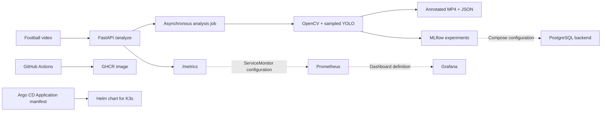

# FootballMatch AI Platform

Local MLOps platform for football-video analysis, combining CPU-based computer vision,
asynchronous model serving, experiment tracking, and automated quality controls.

## Delivered MVP

The MVP turns a video upload into an asynchronous analysis job, an annotated video,
a structured result, and a traceable MLflow experiment run. It includes application
metrics, automated tests, security checks, and a CI-built container image published
to GitHub Container Registry (GHCR).

Platform delivery includes Docker Compose definitions, a Helm chart, a Grafana dashboard
definition, and an Argo CD Application manifest. These deployment assets are versioned
alongside the application.

## Problem and scope

The project intentionally prioritizes MLOps and platform engineering over CV research.
A CPU-friendly pretrained YOLO detector provides the workload. FastAPI serves it,
MLflow records experiments, and the repository packages the service for container and
Kubernetes deployment.



## Implemented capabilities

- FastAPI `/health`, `/ready`, `/metrics`, `/analyze`, `/jobs/{id}`, and `/matches/{id}`.
- CPU-first YOLO11n video inference with deterministic frame sampling.
- Annotated MP4 and JSON summaries; observed baseline processed 190 frames with person
  and sports-ball detections.
- Local MLflow runs with parameters, metrics, tags, output artifacts, and model metadata.
- Standalone, tested K-Means jersey-colour clustering component.
- Asynchronous job lifecycle with explicit `queued`, `running`, `completed`, and `failed` states.
- Docker/Compose definitions for API, MLflow, and PostgreSQL.
- GitHub Actions quality, secret, SAST, container, and image-publication workflow.
- Helm chart, Prometheus metrics, Grafana dashboard definition, and Argo CD Application manifest.

## Validation

| Component | Evidence |
| --- | --- |
| Application | 26 passing tests covering the API, job lifecycle, video pipeline, tracking, and clustering |
| Python quality | Ruff checks pass locally and in GitHub Actions |
| Video baseline | 190 sampled frames processed; annotated MP4 verified with FFprobe |
| Experiment tracking | Local MLflow run with parameters, metrics, metadata, and output artifacts |
| CI and packaging | Successful quality/security jobs, Docker build, and GHCR publication |
| Kubernetes packaging | Helm lint and template rendering pass |

See the [CI workflow](https://github.com/farah-ben-harb/footballmatch-ai-platform-mlops/actions/workflows/ci.yml),
[video baseline evidence](docs/phases/phase-02-cv-baseline.md), and
[MLflow run evidence](docs/phases/phase-03-mlflow-tracking.md).

## Run locally

Requirements: Python 3.10, FFmpeg, and a permitted football video at `data/raw/match.mp4`.

```powershell
python -m venv .venv
.\.venv\Scripts\python.exe -m pip install -e ".[dev]"
.\.venv\Scripts\python.exe -m pytest -q
.\.venv\Scripts\python.exe scripts\analyze_video.py --input data\raw\match.mp4
.\.venv\Scripts\python.exe -m uvicorn footballmatch_api.main:app --host 127.0.0.1 --port 8000
```

Upload with PowerShell:

```powershell
Invoke-RestMethod -Method Post -Uri http://127.0.0.1:8000/analyze -Form @{ file = Get-Item data\raw\match.mp4 }
```

Poll the returned ID with `GET /jobs/{id}` and retrieve completed results with
`GET /matches/{id}`. Interactive API documentation is available at
`http://127.0.0.1:8000/docs` while the service is running.

The detector downloads its pretrained weights on first use; subsequent runs can use
the cached weights locally. Generated data, artifacts, MLflow files, model weights,
and `.env` remain outside Git.

## Deployment assets

The Compose topology defines API, MLflow, and PostgreSQL services with persistent
volumes. PostgreSQL stores MLflow tracking data; API job state is process-local.
Copy `.env.example` to `.env`, set a strong PostgreSQL password, then execute on a
local Docker host. The Windows deployment path uses Docker Desktop with WSL2 and k3d.

```bash
docker compose up --build -d
docker compose ps
```

The [Helm chart](helm/footballmatch-ai-platform) defines a single API replica, health
probes, resource requests/limits, a persistent volume, and optional monitoring resources.
The [Argo CD Application](gitops/argocd/footballmatch-application.yaml) declares automated
sync and self-healing with a CI-published commit-SHA image tag. Kubernetes packaging
and GitOps configuration are documented in [Phase 6](docs/phases/phase-06-kubernetes-observability.md) and
[Phase 7](docs/phases/phase-07-gitops-argocd.md).

## Testing and security

```powershell
.\.venv\Scripts\python.exe -m pytest -q
.\.venv\Scripts\python.exe -m ruff check .
helm lint helm\footballmatch-ai-platform
```

GitHub Actions runs Gitleaks, Semgrep, a Docker build, and a blocking Trivy filesystem
scan for dependency and IaC vulnerabilities. Image publication depends on those checks.
The container runs as a non-root user. See [SECURITY.md](SECURITY.md) for the security
controls and guidance for operating the service.

## Design choices and operating scope

- CPU inference and sampled frames keep the workload practical on a local machine.
- The detector reports `person` and `sports ball`; counts are observations per frame,
  not tracked player identities or referee classifications.
- Job state is process-local, so the API uses one process and one replica. Restarts
  clear the job index; generated output files are stored separately.
- K-Means demonstrates colour-based ML independently of the video-analysis pipeline.
- The service targets a trusted local environment. Authentication and TLS belong at
  the boundary before exposing the API externally.

## Extensions

Durable job storage, queue-backed workers, MLflow Model Registry integration, and a
local RAG assistant are extension paths beyond this MVP's video-analysis and
experiment-tracking scope.

## Documentation

- `docs/phases/`: implementation evidence, validation, limitations, and PR summaries.
- `docs/learning/`: concepts, trade-offs, and interview answers.
- `docs/release/`: v0.1.0 release checklist and portfolio evidence plan.
