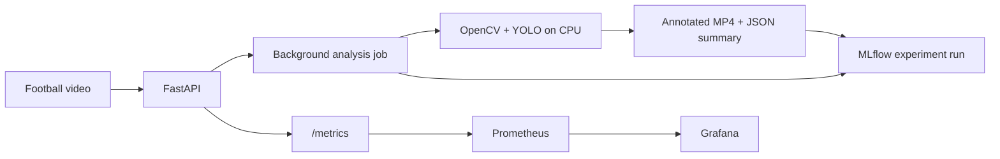

# FootballMatch AI Platform

A local MLOps platform that turns football videos into annotated footage, structured
analysis, and traceable MLflow experiments.

[](https://github.com/farah-ben-harb/footballmatch-ai-platform-mlops/actions/workflows/ci.yml)

[Architecture](#architecture) · [Quick start](#quick-start) · [API](#api-reference) ·
[Deployment](#deployment) · [Validation](#validation-and-security)

## Overview

FootballMatch AI Platform uses football-video analysis to demonstrate how to serve,
track, test, package, and observe an AI workload. A pretrained detector keeps the
focus on MLOps and platform engineering rather than model research.

The MVP runs on a CPU, uses local storage, and requires no paid cloud service or AI API.
The repository includes the application, automated CI, container packaging, and
versioned Kubernetes, monitoring, and GitOps deployment configurations.

## Key capabilities

- **Video analysis:** OpenCV frame sampling and YOLO11n detection of people and sports balls.
- **Asynchronous API:** video uploads, background jobs, status polling, and structured results with FastAPI.
- **Experiment tracking:** MLflow parameters, metrics, tags, annotated videos, and model/run metadata.
- **ML component:** a standalone scikit-learn K-Means component for jersey-colour clustering.
- **Observability:** Prometheus metrics for requests, latency, jobs, frames, detections, and inference duration.
- **Delivery automation:** tests, linting, security checks, Docker builds, and GHCR image publication.

## Architecture



Locally, MLflow stores runs in `mlruns/`. The Compose configuration uses PostgreSQL
for MLflow metadata and a separate volume for artifacts. API job state is process-local.

The platform configuration adds a Helm chart for the API, a lightweight
Prometheus/Grafana Compose overlay, a versioned dashboard, and an Argo CD
Application manifest. The optional ServiceMonitor is disabled because this VM
does not run Prometheus Operator.

### Optional local RAG assistant

The RAG extension converts completed analysis summaries into chunks, embeds them
with a local sentence-transformers model, and stores 384-dimensional vectors in
PostgreSQL with pgvector. `POST /rag/ask` retrieves relevant chunks and asks
Ollama for an answer that includes source references. `GET /rag/status` shows
configuration without loading the models. Automatic indexing is opt-in through
`FOOTBALLMATCH_RAG_AUTO_INDEX`; the core video job remains successful if
indexing fails. See [Phase 8](docs/phases/phase-08-rag-assistant.md) for design,
validation scope, and limitations. The K3s deployment was also validated
against external PostgreSQL/pgvector and Ollama: a Pod request returned a
grounded answer with retrieved source passages.

## Quick start

Prerequisites: Git, Python 3.10, and FFmpeg/FFprobe on `PATH`. The Windows examples
use PowerShell 7 and the Python launcher (`py`). No GPU is required. The first
inference downloads `yolo11n.pt`; later runs can reuse the cached weights.

### 1. Get the project

```bash
git clone --branch main https://github.com/farah-ben-harb/footballmatch-ai-platform-mlops.git football-match-ai-platform
cd football-match-ai-platform
```

### 2. Install and start the API

Windows / PowerShell 7:

```powershell
py -3.10 -m venv .venv
.\.venv\Scripts\python.exe -m pip install -e ".[dev]"
$env:FOOTBALLMATCH_RUNTIME_DIRECTORY = "artifacts/runtime"
.\.venv\Scripts\python.exe -m uvicorn footballmatch_api.main:app --host 127.0.0.1 --port 8000
```

<details>
<summary>Linux equivalent</summary>

```bash
python3.10 -m venv .venv
.venv/bin/python -m pip install -e ".[dev]"
export FOOTBALLMATCH_RUNTIME_DIRECTORY=artifacts/runtime
.venv/bin/python -m uvicorn footballmatch_api.main:app --host 127.0.0.1 --port 8000
```

</details>

Keep this terminal running. Open the [interactive API documentation](http://127.0.0.1:8000/docs)
or check [process health](http://127.0.0.1:8000/health), which returns `{"status":"ok"}`.
The runtime setting above keeps uploads and outputs inside the Git-ignored `artifacts/` directory.

### 3. Analyze a video

On Ubuntu, download the short sample with:

```bash
chmod +x scripts/download_sample_video.sh
./scripts/download_sample_video.sh
```

Requires `curl`, `ffmpeg` with the `libx264` encoder, and `ffprobe`. The helper downloads
only a 9.2-second WebM (about 5.3 MiB), converts it to H.264 MP4 at 25 FPS without audio, and
validates the codec and duration. It creates `data/raw/match.mp4`, prints its size,
and refuses to overwrite an existing file. Temporary files are cleaned up on failure.
The existing `data/` Git ignore rule excludes the clip from commits.

Sample: [Girls football training](https://commons.wikimedia.org/wiki/File:Girls_football_training.webm)
by Evworo, licensed under [CC BY-SA 3.0](https://creativecommons.org/licenses/by-sa/3.0/).
Changes: MP4/H.264 conversion at 25 FPS and removal of audio. If sharing the converted sample
or annotated derivatives, retain attribution, identify your changes, and follow the
license's ShareAlike terms. This training footage is a smoke-test input, not a detection benchmark.

Alternatively, place your own permitted short clip at `data/raw/match.mp4`.
Videos are not bundled with the repository.

In a second PowerShell 7 terminal, from the repository root:

```powershell
$baseUrl = "http://127.0.0.1:8000"
$job = Invoke-RestMethod -Method Post -Uri "$baseUrl/analyze" -Form @{ file = Get-Item "data/raw/match.mp4" }
$job
```

The API returns HTTP `202` with a job `id` and a `status_url`. Check its progress:

```powershell
Invoke-RestMethod -Uri "$baseUrl/jobs/$($job.id)"
```

Repeat the status request until the job is `completed` or `failed`. A failed job
includes an `error` field. Once completed, retrieve the analysis:

```powershell
Invoke-RestMethod -Uri "$baseUrl/matches/$($job.id)" | ConvertTo-Json -Depth 6
```

The response contains the detection summary, frame count, timing measurements,
output path, and `mlflow_run_id`. With the runtime setting above, files are written to:

```text
artifacts/runtime/jobs/<job-id>/annotated.mp4
artifacts/runtime/jobs/<job-id>/summary.json
```

Linux users can upload and inspect results through the same interactive API documentation.

### 4. Inspect experiments

In another terminal at the repository root, start the local MLflow interface:

```powershell
.\.venv\Scripts\python.exe -m mlflow ui --backend-store-uri ./mlruns --host 127.0.0.1 --port 5000
```

Open [MLflow](http://127.0.0.1:5000) and select `football-video-analysis` to compare
run parameters, performance metrics, detection counts, and output artifacts.
On Linux, use `.venv/bin/python` in place of the Windows interpreter path.

## API reference

| Method | Endpoint | Purpose |
| --- | --- | --- |
| `GET` | `/health` | Process health |
| `GET` | `/ready` | API readiness response and environment |
| `POST` | `/analyze` | Upload a video and receive a job ID |
| `GET` | `/jobs/{id}` | Job status, error, and available result |
| `GET` | `/matches/{id}` | Completed analysis; returns `409` while incomplete |
| `GET` | `/metrics` | Prometheus metrics |

Supported upload extensions: `.mp4`, `.mov`, `.avi`, `.mkv`, and `.webm`.
The default upload limit is 100 MB (100,000,000 bytes). Readiness describes the API;
the detector loads lazily on the first analysis job.

For batch analysis without running the API:

```powershell
.\.venv\Scripts\python.exe scripts/analyze_video.py --input data/raw/match.mp4 --sample-fps 5 --confidence 0.25
```

This produces `artifacts/annotated-match.mp4`, `artifacts/analysis-summary.json`, and
an MLflow run. Linux users can use the same arguments with `.venv/bin/python` and
`scripts/analyze_video.py`.

## Deployment

| Asset | Scope |
| --- | --- |
| [Dockerfile](Dockerfile) | API image with FFmpeg and a non-root runtime user |
| [Docker Compose](compose.yaml) | API, MLflow, PostgreSQL, and persistent volumes |
| [Observability Compose overlay](compose.observability.yaml) | Lightweight Prometheus and Grafana with data on `/data` |
| [Helm chart](helm/footballmatch-ai-platform) | API Deployment, Service, probes, resources, storage, and monitoring configuration |
| [Grafana dashboard](helm/footballmatch-ai-platform/dashboards/footballmatch-api.json) | Dashboard definition for application metrics |
| [Argo CD Application](gitops/argocd/footballmatch-application.yaml) | GitOps configuration with automated sync, self-healing, and a commit-SHA image tag |

On a Docker host, copy `.env.example` to `.env` and replace the PostgreSQL password
placeholder before starting the stack:

```bash
docker compose up --build -d
docker compose ps
```

Compose publishes the API on port `8000` and MLflow on port `5000`; stop any native
processes using these ports first. PostgreSQL binds port `15432` to loopback by
default. The K3s VM can use an ignored local `.env` setting to bind this port to
the host bridge for Pod access.
For Windows, use a Docker host such as Docker Desktop with its WSL2 backend.

### K3s deployment validated on the Ubuntu VM

The single canonical Chart is `helm/footballmatch-ai-platform`. It runs one
non-root API Pod with a ClusterIP Service, probes, resource limits, and a
local-path PVC. PostgreSQL and MLflow remain in Docker Compose; the K3s API
reaches MLflow through the VM host address. The validated RAG setup reaches
PostgreSQL/pgvector and Ollama through the host bridge; the database password
is injected from a Kubernetes Secret, and automatic indexing is enabled.

The GHCR package is private. Authorize `read:packages`, then create the
`ghcr-pull` Secret from your operator machine. The helper reads the token on
stdin and never stores it in Git or a shell argument:

```powershell
gh auth refresh --scopes read:packages
$vm = "farahbenharb@192.168.17.165"  # replace with your SSH target
gh auth token | ssh $vm 'cd ~/footballmatch-ai-platform-mlops && ./scripts/create_ghcr_pull_secret.sh footballmatch ghcr-pull farah-ben-harb'
```

The operator machine needs GitHub CLI and SSH; the VM needs `kubectl`. From
the repository root on the VM, after publishing an image:

```bash
VM_IP=REPLACE_WITH_REACHABLE_VM_IP
IMAGE_SHA="$(git rev-parse main)"  # use a main commit whose CI published the image
helm upgrade --install footballmatch helm/footballmatch-ai-platform \
  --namespace footballmatch --create-namespace \
  --set image.tag="sha-${IMAGE_SHA}" \
  --set 'imagePullSecrets[0].name=ghcr-pull' \
  --set-string config.mlflowTrackingUri="http://${VM_IP}:5000"
kubectl rollout status deployment/footballmatch-footballmatch-ai-platform -n footballmatch
kubectl get pods,svc,pvc -n footballmatch
kubectl port-forward -n footballmatch svc/footballmatch-footballmatch-ai-platform 18000:8000
```

While the port-forward runs, call `http://127.0.0.1:18000/health`,
`/ready`, and `/metrics` from another VM terminal. The validated deployment
processed the 8.68-second sample clip, wrote an annotated MP4 to its PVC, and
recorded a finished MLflow run. The PyTorch image took about 20 minutes to
pull on this VM; check `df -h /` before adding more K3s workloads.

Deployment details and evidence are in
[Phase 6](docs/phases/phase-06-kubernetes-observability.md). The Argo CD
configuration is described in [Phase 7](docs/phases/phase-07-gitops-argocd.md).

### Lightweight Prometheus and Grafana

The API exposes `/metrics`. A small Compose overlay scrapes the K3s Service
directly from the same VM and provisions a Grafana dashboard. No Prometheus
Operator is installed, so the optional Helm ServiceMonitor stays disabled.
Prometheus and Grafana persist on `/data/footballmatch-observability`; their
web ports bind only to VM loopback. The dashboard covers HTTP rate/errors/p95
latency, video jobs/frames/duration, inference, detections, and RAG
requests/errors/retrieval/generation latency.

Set `K3S_API_SERVICE_IP` in the ignored `.env` to the output of
`kubectl get svc footballmatch-footballmatch-ai-platform -n footballmatch -o jsonpath='{.spec.clusterIP}'`.
Also set a random `GRAFANA_ADMIN_PASSWORD` there. Create writable
`prometheus` (UID 65534) and `grafana` (UID 472) directories under
`/data/footballmatch-observability`, then start only the monitoring services:

```bash
docker compose -f compose.yaml -f compose.observability.yaml --profile observability config --quiet
docker compose -f compose.yaml -f compose.observability.yaml --profile observability up -d prometheus grafana
```

From Windows, keep a terminal open with this SSH tunnel (replace the VM
username and address):

```powershell
ssh -L 3000:127.0.0.1:3000 -L 9090:127.0.0.1:9090 USER@VM_IP
```

Open http://127.0.0.1:3000 for Grafana and sign in as `admin` with the
password from your local ignored `.env`. The FootballMatch dashboard is
provisioned in the FootballMatch folder. Prometheus is available at
http://127.0.0.1:9090.

On the VM, Prometheus listens at `127.0.0.1:9090` and Grafana at
`127.0.0.1:3000`. Use SSH port forwarding for access from Windows.
The configured K3s Service IP is specific to this single-node VM and must be
refreshed if the Service is recreated. See [Phase 6](docs/phases/phase-06-kubernetes-observability.md).

## Validation and security

```powershell
.\.venv\Scripts\python.exe -m pytest -q
.\.venv\Scripts\python.exe -m ruff check .
helm lint helm\footballmatch-ai-platform
```

Helm is required only for chart validation. On Linux, use `.venv/bin/python` and
`helm lint helm/footballmatch-ai-platform`.

| Validation | Evidence |
| --- | --- |
| Application | CI tests cover API, jobs, video pipeline, tracking, RAG, and clustering |
| Video baseline | 190 sampled frames processed; annotated MP4 verified with FFprobe |
| Experiment tracking | Recorded local run with parameters, metrics, metadata, and output artifacts |
| Packaging | Successful Docker build and GHCR publication; Helm lint and template rendering pass |

The [CI workflow](.github/workflows/ci.yml) runs Ruff, pytest, Gitleaks secret scanning,
Semgrep SAST, a Docker build, and a blocking Trivy filesystem scan for dependency
and infrastructure-as-code vulnerabilities. Image publication runs after successful
checks on `main` or a manually dispatched feature-branch run. Trivy's filesystem scan is separate from a full container-image scan.

Read [SECURITY.md](SECURITY.md) for operating guidance. The service targets a trusted
local environment; add authentication, TLS, and network restrictions before external exposure.

## Engineering decisions

- Sampled CPU inference controls compute cost without requiring GPU training.
- `person` includes players, referees, and spectators. Counts are per-frame observations,
  not unique identities; ball detection is sensitive to size, blur, and occlusion.
- Job state is process-local. Use one API process and one replica; restarts clear the
  job index even when output files remain on disk.
- K-Means is an independent colour-clustering component, not automatic team assignment
  in the video pipeline.

## Repository guide

```text
src/footballmatch_api/   API, inference, job service, MLflow, metrics, and clustering
scripts/                Command-line video analysis
tests/                  Automated application tests
docker/                 MLflow container packaging
helm/                   Kubernetes chart and dashboard definition
gitops/                 Argo CD configuration
docs/                   Implementation evidence and technical explanations
```

- [Video baseline evidence](docs/phases/phase-02-cv-baseline.md)
- [MLflow tracking evidence](docs/phases/phase-03-mlflow-tracking.md)
- [Implementation recaps](docs/phases/) and [concept guides](docs/learning/)
- [Release checklist](docs/release/v0.1.0-checklist.md)

Extension paths include durable jobs, queue-backed workers, MLflow Model Registry
integration, and a local RAG assistant.
