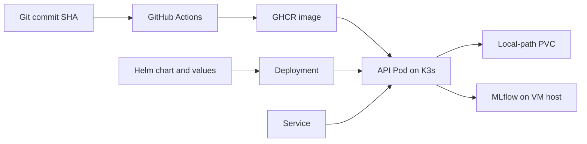

# Concepts  Phase 06: Kubernetes deployment

## Mental model / workflow

The API is the Kubernetes workload. PostgreSQL and MLflow remain in Docker Compose
on the same VM for this phase. RAG automatic indexing is off until PostgreSQL
has a deliberate, secured network path into the cluster.

## K3s and Kubernetes

### Definition

Kubernetes is a reconciliation system: controllers compare declared desired state
with observed cluster state and create or replace resources until they match.
K3s packages the control plane and node components for a small cluster.

### Why it exists

A container runtime starts one container, but it does not maintain replicas,
roll out changes, give stable service names, or schedule workloads by resources.

### How it works

The API server stores objects, the scheduler assigns Pods to nodes, and
controllers keep Deployments and ReplicaSets at their desired replica count.
Kubelet starts and probes the containers through containerd.

### Architecture position and example

One K3s node runs one FootballMatch API Pod. Docker Compose continues to run
PostgreSQL and MLflow outside Kubernetes.

### Alternatives, advantages, and limitations

Compose is simpler for one host but has no Kubernetes controller model.
A managed cluster reduces control-plane operations but requires a provider.
Single-node K3s has no high availability.

### Production and security considerations

Use RBAC, resource quotas, network policy where supported, image provenance,
and backups. K3s here demonstrates deployment mechanics, not a highly
available production cluster.

## Deployment, Pod, ReplicaSet, and Service

### Definition and why they exist

A Pod is the schedulable unit containing the API container. A Deployment
declares the desired number of Pods and creates ReplicaSets for revisions.
A ClusterIP Service supplies a stable virtual IP and name for ready Pods.

### How they work in this project

The Deployment keeps one API Pod. Its selector and the Service selector use
the same labels. The Service forwards port 8000 to the Pod's named HTTP port.
A port-forward exposes that Service temporarily on the operator's machine.

### Alternatives and limitations

A StatefulSet gives stable Pod identities for stateful workloads; the API
itself does not need one. NodePort or Ingress can expose traffic persistently,
but port-forward is safer for a local demo. Job state remains in process memory,
so a restart loses the job index. More replicas would route requests to
different in-memory indexes; keep one replica until a durable queue and store exist.

## Helm and immutable images

### Definition and why they exist

Helm renders Kubernetes YAML from a versioned chart and values, then records
a release history. An immutable image tag identifies a build by commit SHA.

### How they work in this project

The single canonical chart is `helm/footballmatch-ai-platform`.
`helm lint` checks chart structure; `helm template` shows the exact manifests;
`helm upgrade --install` applies them. The deployed image uses a `sha-...`
tag rather than a mutable `latest` tag.

### Alternatives and common mistakes

Raw YAML is straightforward but repeats configuration. Kustomize patches
manifests without templates. Argo CD is a reconciler and can consume Helm;
it is not another chart. A common mistake is changing `latest` without
changing the Pod spec, so Kubernetes may keep the old image.

## ConfigMap and Secret

### Definition and why they exist

A ConfigMap holds non-sensitive environment configuration. A Secret holds
sensitive bytes, such as database passwords and registry credentials.

### How they work in this project

Helm renders API settings into a ConfigMap. The GHCR pull credential lives
in a Kubernetes Secret created outside Git. The chart can reference another
existing Secret for RAG database credentials when that integration is enabled.

### Production and security considerations

Kubernetes Secret is base64-encoded, not encrypted by default. Restrict RBAC,
enable encryption at rest where needed, rotate credentials, and never commit
Secret manifests containing real values. Avoid printing credentials in logs.

## PV, PVC, StorageClass, and local-path

### Definition and why they exist

A PVC requests a volume; a PV is the actual volume satisfying that claim.
A StorageClass defines how a provisioner creates PVs. K3s local-path creates
node-local directories for claims.

### How they work in this project

The runtime PVC stores uploads and output files under `/app/runtime`.
The Pod's `fsGroup` lets the non-root application write to that volume.

### Alternatives and limitations

`emptyDir` loses files when a Pod is removed. Network storage supports
multi-node access but adds complexity. Local-path does not make data highly
available and a 10Gi request is not necessarily a hard quota.

## Liveness, readiness, requests, and limits

### Definition and why they exist

Liveness answers whether kubelet should restart a container. Readiness
answers whether the Service should route traffic to it. Requests reserve
scheduler capacity; limits cap CPU or memory use.

### How they work in this project

`/health` is the liveness endpoint and `/ready` is readiness.
The API requests 500m CPU and 1Gi memory, with 2 CPU and 4Gi limits.

### Limitations and common mistakes

The current readiness endpoint checks process availability, not MLflow,
PostgreSQL, model loading, or Ollama. Do not describe it as an end-to-end
dependency probe. A tight memory limit can kill CPU inference with OOMKilled;
watch real usage before tuning.

## Networking between K3s and Docker Compose

### Definition and why it exists

Kubernetes Service DNS resolves only Services in the cluster. Docker Compose
service names resolve only on their Compose network. A Pod therefore cannot
assume that `mlflow`, `postgres`, or `ollama` are Kubernetes DNS names merely
because those containers run on the same VM.

### How it works in this project

Compose publishes MLflow on the VM's port 5000. The API Pod uses a
non-secret ConfigMap setting pointing to the VM address and port. A temporary
BusyBox Pod confirmed that `/health` returned `OK` from MLflow. PostgreSQL is now bound to a host bridge address on port 15432, so the
K3s Pod can retrieve pgvector chunks without moving the database.

### Alternatives and production considerations

The services could be moved into Kubernetes, reached through secured
host-published ports, or placed behind a controlled in-cluster proxy.
For this small VM, keeping the existing database and MLflow in Compose avoids
duplicating large stateful services. In production, use private networking,
authentication, TLS, and a stable service endpoint.

## Commands to remember

| Command | Role | When to use |
| --- | --- | --- |
| `kubectl get nodes` | Check node state | Before deployment |
| `kubectl get pods,svc,pvc -n footballmatch` | See workload, routing, and storage | During validation |
| `kubectl describe pod <name> -n footballmatch` | Read events and scheduling reasons | Pod stuck or failing |
| `kubectl logs deployment/footballmatch-footballmatch-ai-platform -n footballmatch` | Read application logs | Startup or runtime failure |
| `kubectl get events -n footballmatch --sort-by=.metadata.creationTimestamp` | Inspect recent cluster decisions | Image pull or volume failure |
| `helm lint helm/footballmatch-ai-platform` | Validate chart structure | Before commit |
| `helm template footballmatch helm/footballmatch-ai-platform` | Inspect rendered resources | Before applying |
| `helm upgrade --install footballmatch helm/footballmatch-ai-platform -n footballmatch` | Reconcile release | Deployment and upgrade |
| `kubectl port-forward -n footballmatch svc/footballmatch-footballmatch-ai-platform 18000:8000` | Access ClusterIP locally | API smoke test |

## Interview questions and answers

1. **Why a Deployment instead of a bare Pod?** A Deployment recreates failed
   Pods and records rollout revisions.
2. **Why a Service?** Pod IPs change; a Service provides stable routing to
   Pods selected by labels.
3. **Readiness versus liveness?** Readiness controls traffic; liveness
   requests a restart.
4. **ConfigMap versus Secret?** Both inject configuration, but Secrets are
   intended for sensitive values and require tighter access controls.
5. **Why one replica?** The job index is in memory and the PVC is node-local;
   replicas would disagree about job state.
6. **Why a PVC?** Uploads and outputs must survive a Pod replacement.
7. **What does a StorageClass do?** It selects the provisioner and policy
   used to create storage for a PVC.
8. **Why a SHA image tag?** It identifies the exact build for audit and
   rollback.
9. **Helm versus Argo CD?** Helm packages and renders a release; Argo CD
   compares Git with the cluster and continuously syncs the desired state.
10. **What changes in a multi-node production cluster?** Use durable shared
    job state, a queue, multi-node storage, network policies, and a highly
    available database and control plane.

## Prometheus scraping and Grafana dashboards

### Definition and why they exist

Prometheus is a time-series monitoring system. It periodically scrapes
`/metrics`, stores timestamped samples, and evaluates PromQL queries.
Grafana displays those queries as panels. This separates metric collection
from visualization and lets engineers inspect trends rather than isolated logs.

### How they work in FootballMatch

The API exposes counters (HTTP requests, jobs, frames, detections, RAG
requests/errors) and histograms (HTTP latency, full video-job duration,
inference, retrieval, and generation). Prometheus in Docker Compose scrapes
the stable K3s Service IP through the VM's local routing. Grafana uses a
provisioned Prometheus data source and a versioned dashboard JSON file.
The dashboard is read-only from Git, while Grafana's database persists on
`/data`. Both web interfaces bind to loopback for SSH-tunnel access.

### Alternatives, advantages, and limitations

A Prometheus Operator with ServiceMonitor is useful in a larger cluster,
but adds controllers and CRDs to this two-CPU VM. Static scraping in Compose
is sufficient for one API target. The Service IP can change if recreated;
refresh the ignored `.env` setting then recreate Prometheus. Local storage
does not provide high availability. Seven-day and 2 GB Prometheus retention
limits data growth; `/data` capacity still needs monitoring.

### Security and common mistakes

Keep Grafana's admin password in ignored local configuration. Bind admin
ports to loopback. Never enable a ServiceMonitor without its CRD/operator.
A counter's raw value is cumulative; use `rate()` for per-second traffic and
`increase()` for counts over an interval. Histograms provide bucketed
latency distributions; p95 requires `histogram_quantile()` over bucket
rates. A successful `/metrics` HTTP response alone does not prove that
Prometheus scraped it; query `up{job="footballmatch-k3s"}`.

### Interview questions and answers

1. **Prometheus versus Grafana?** Prometheus collects and queries metrics;
   Grafana visualizes those queries.
2. **Why scrape a Service instead of a Pod IP?** The Service remains stable
   across Pod replacements.
3. **What does `up=1` mean?** The latest scrape succeeded; it does not prove
   every application operation is healthy.
4. **Counter versus histogram?** A counter grows monotonically; a histogram
   records observations into buckets plus sum and count.
5. **Why retain only seven days?** It limits disk use on this local VM.
6. **Why no ServiceMonitor?** No Prometheus Operator is installed; static
   scraping needs no CRD.
7. **Why keep monitoring data on `/data`?** The root filesystem has little
   free space and previously entered DiskPressure.
8. **How do you measure p95 latency?** Aggregate bucket rates by `le`
   and apply `histogram_quantile(0.95, ...)`.

### Commands to remember for this extension

| Command | Role | When to use |
| --- | --- | --- |
| `docker compose -f compose.yaml -f compose.observability.yaml --profile observability config --quiet` | Check combined configuration without printing passwords | Before startup or after edits |
| `docker compose -f compose.yaml -f compose.observability.yaml --profile observability up -d prometheus grafana` | Start only the monitoring services | After storage and environment setup |
| `kubectl get svc -n footballmatch` | Discover the K3s scrape endpoint | When Service IP changes |
| `curl http://127.0.0.1:9090/api/v1/targets` | Check target health | After Prometheus starts |
| `curl http://127.0.0.1:3000/api/health` | Check Grafana process and database | After Grafana starts |
| `df -h / /data` | Check image and TSDB storage headroom | Before and after a rollout |
