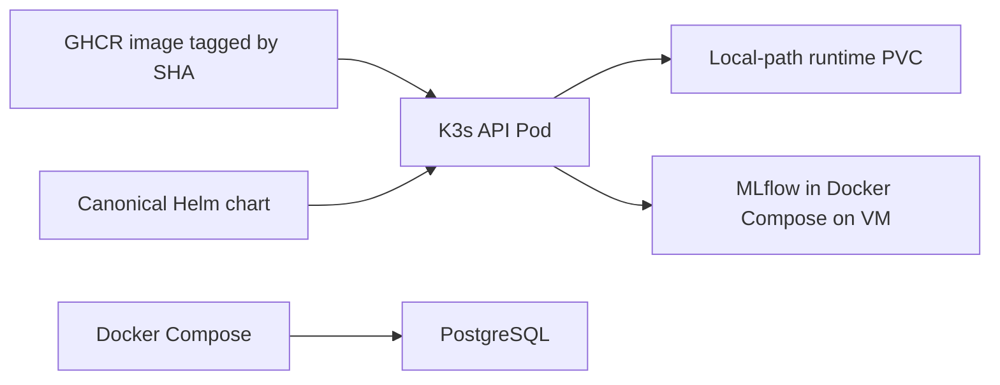

# Phase 06  Kubernetes and Helm deployment

## Objective

Run the FootballMatch API on the existing single-node K3s cluster with one
canonical Helm chart, an immutable image, a persistent runtime directory,
health probes, and constrained resources.

## Starting state

K3s was Ready with three healthy system Pods and the local-path StorageClass.
No application release existed. The repository had two charts with different
configuration assumptions; the newer one referenced Kubernetes DNS names
for PostgreSQL, MLflow, and Ollama that did not exist in this cluster.
The VM had about 7.5 GiB free on `/` and 31 GiB on `/data`.

## Architecture

The API has one replica because its job index is process-local. PostgreSQL
and MLflow stay in Compose to avoid duplicating stateful services in a
small VM. RAG automatic indexing is off in K3s until PostgreSQL is
reachable through a deliberate, secured route.

## What was implemented

- Kept `helm/footballmatch-ai-platform` as the single chart already used
  by README and Argo CD; removed `helm/footballmatch-ai`.
- Added image pull Secret support, RAG-related configuration, a non-root
  security context, ConfigMap rollout checksum, and a single-Pod Recreate
  strategy for the local runtime PVC.
- Disabled ServiceMonitor and Grafana dashboard by default until the
  monitoring stack is installed.
- Added a manual CI dispatch so feature images can be published with a
  commit-SHA tag without moving `latest` away from main.

## Files added or modified

- `helm/footballmatch-ai-platform/Chart.yaml`, `values.yaml`, and
  templates for Deployment, Service, ConfigMap, PVC, and ServiceMonitor.
- Removed the duplicate `helm/footballmatch-ai/` chart.
- `.github/workflows/ci.yml` for manual SHA image publishing.
- This recap and the corresponding concepts guide.

## Commands executed

| Command | What it does | Important flags | Expected result |
| --- | --- | --- | --- |
| `git status --short --branch` | Checks branch and worktree | `--short` is compact | Feature branch shown |
| `git fetch origin` | Updates remote refs | `origin` names the remote | Current remote branch |
| `helm lint helm/footballmatch-ai-platform` | Validates chart structure | Chart path | 0 failed |
| `helm template footballmatch helm/footballmatch-ai-platform --namespace footballmatch` | Renders YAML without installing | Release and namespace | Valid resources |
| `kubectl -n footballmatch apply --dry-run=server -f -` | Asks API server to validate rendered YAML | `--dry-run=server` avoids persistence | Four accepted resources |
| `kubectl create namespace footballmatch --dry-run=client -o yaml | kubectl apply -f -` | Creates namespace idempotently | YAML piped to apply | Namespace Active |
| `gh workflow run ci.yml --ref feat/k8s-helm` | Publishes a feature image through tested CI | `--ref` selects branch | Successful run |
| `df -h / /data` | Checks disk headroom | Filesystem paths | No DiskPressure |

## Validation

Helm lint, template rendering with monitoring on and off, and Kubernetes
server-side dry-run passed. The manual GitHub Actions run
[40714284652](https://github.com/farah-ben-harb/footballmatch-ai-platform-mlops/actions/runs/40714284652)
passed test, secret scan, SAST, filesystem scan, and image publication.
Live image pull and API smoke tests are pending package read access.

## Tests executed

The CI test job passed. No Python source was changed in this block.
Helm rendering and API-server validation were the focused local tests.

## Evidence

- K3s node `farahbenharb`: Ready, DiskPressure=False.
- `helm lint`: one chart linted, zero failed.
- `kubectl apply --dry-run=server`: ConfigMap, PVC, Service, and
  Deployment accepted.
- GHCR feature image was published by the successful CI run.

## Errors encountered

The VM was suspended and SSH timed out; it was resumed through VMware.
The GitHub connector returned 403 when creating the PR, so the
authenticated GitHub CLI was used. The current CLI token lacks GHCR
package read permission, and the package is private.

## Root causes

A suspended guest has no reachable SSH service. The connector has
insufficient PR permissions in this environment. GitHub repository
visibility and GHCR package visibility are independent settings.

## Fixes

Resumed the correct `D:\vm\Storage\StorageNode.vmx` guest and
verified SSH before continuing. Opened the PR with `gh`.
Created a pull Secret outside Git; package visibility or
`read:packages` authorization is still required for actual pulls.

## Security considerations

No credentials, private keys, database passwords, or video binaries
were committed. The API runs as UID/GID 999, denies privilege escalation,
drops Linux capabilities, and uses the RuntimeDefault seccomp profile.
The GHCR pull Secret is stored in Kubernetes, not in Git.

## DevOps / MLOps best practices applied

One chart is the source of truth; image tags are immutable; configuration
is externalized; probes and resource requests/limits are set; one replica
matches the in-memory job model; CI gates image publication.

## Git / PR summary

Changes are on `feat/k8s-helm`, not `main`. The PR targets
`feat/rag-platform` because the Kubernetes branch is based on that
unmerged RAG branch. This keeps the PR diff focused.

## Limitations

The `/ready` endpoint checks process readiness, not MLflow, database,
Ollama, or model loading. Local-path storage is node-local and its size
request is not a hard disk quota. RAG queries are not validated from K3s.
The live API deploy remains pending the GHCR package access step.

## Next phase

Validate the live Pod, Service, PVC, port-forward, `/health`,
`/ready`, and `/metrics`. Then configure monitoring and Grafana
in a separate observability block.

## How I would explain this phase in an interview

"I consolidated two Helm charts into one deployment source of truth.
The chart runs a non-root FastAPI Pod on K3s with probes, resource limits,
and a local-path PVC. CI publishes an image tagged by commit SHA, and
the cluster pulls it using a Secret kept outside Git. I kept stateful
dependencies in Compose to fit a small VM, and I use one API replica
because job state is currently in memory."
