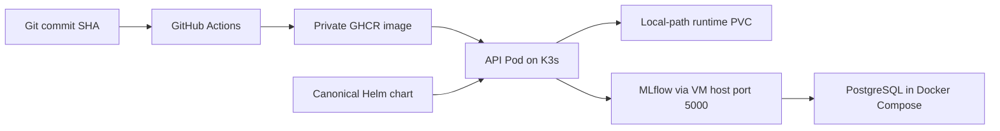

# Phase 06  Kubernetes and Helm deployment

## Objective

Deploy the FootballMatch API on the existing single-node K3s cluster with one
canonical Helm chart, an immutable image, persistent runtime storage, health
probes, and resource controls. Validate a real video analysis and MLflow run.

## Starting state

K3s was Ready with three healthy system Pods and the `local-path` StorageClass.
No application release existed. Two Charts contained incompatible defaults; the
newer Chart assumed Kubernetes DNS names for PostgreSQL, MLflow, and Ollama that
did not exist. The VM had about 7.5 GiB free on `/` and 31 GiB on `/data`.

## Architecture

The API has one replica because its job index is process-local. PostgreSQL and
MLflow remain in Compose to avoid duplicating stateful services on a small VM.
RAG auto-indexing is off in K3s until PostgreSQL has a deliberate secured
network route. The private GHCR image is pulled with a Kubernetes Secret created
outside Git.

## What was implemented

- Kept `helm/footballmatch-ai-platform` as the single Chart already used by
  README and Argo CD; removed `helm/footballmatch-ai`.
- Added image pull Secret support, RAG configuration, non-root UID/GID 999,
  `fsGroup`, RuntimeDefault seccomp, no privilege escalation, dropped
  capabilities, ConfigMap rollout checksum, probes, resource limits, and a
  single-Pod Recreate strategy for the local runtime PVC.
- Disabled ServiceMonitor and Grafana resources by default until the monitoring
  stack and CRDs are installed.
- Added manual CI dispatch to publish a feature image tagged by commit SHA.
- Installed the Helm release on K3s and used the real short football clip to
  validate API upload, inference, PVC output, and MLflow tracking.

## Files added or modified

- `helm/footballmatch-ai-platform/Chart.yaml`, `values.yaml`, and templates
  for Deployment, Service, ConfigMap, PVC, and ServiceMonitor.
- Removed the duplicate `helm/footballmatch-ai/` Chart.
- `.github/workflows/ci.yml` for manual SHA image publishing.
- `scripts/create_ghcr_pull_secret.sh` for secret creation through stdin.
- `README.md`, this recap, and the corresponding learning guide.

The football video, Kubernetes Secrets, and generated outputs are not in Git.

## Commands executed

| Command | What it does | Important flags | Expected output |
| --- | --- | --- | --- |
| `git status --short --branch` | Checks branch and worktree | `--short` is compact | `feat/k8s-helm` |
| `git fetch origin` | Refreshes remote refs | `origin` is the remote | Updated refs |
| `helm lint helm/footballmatch-ai-platform` | Validates the Chart | Chart path | 0 failed |
| `helm template footballmatch helm/footballmatch-ai-platform --namespace footballmatch` | Renders YAML without installing | Release and namespace | Valid manifests |
| `kubectl -n footballmatch apply --dry-run=server -f -` | Validates rendered YAML on the API server | `--dry-run=server` avoids persistence | Four accepted resources |
| `gh workflow run ci.yml --ref feat/k8s-helm` | Builds and publishes the feature image | `--ref` selects branch | Successful run |
| `gh auth refresh --scopes read:packages` | Grants GHCR package read to GitHub CLI | OAuth scope | Authorized CLI |
| `gh auth token | ssh VM './scripts/create_ghcr_pull_secret.sh footballmatch ghcr-pull USER'` | Streams token over SSH and applies pull Secret | Token on stdin | Secret configured |
| `helm upgrade --install footballmatch helm/footballmatch-ai-platform -n footballmatch` | Installs or updates the release | `--install` handles first run | Release deployed |
| `kubectl rollout status deployment/footballmatch-footballmatch-ai-platform -n footballmatch` | Waits for a Ready Pod | Deployment name | Successfully rolled out |
| `kubectl get pods,svc,pvc -n footballmatch` | Checks runtime objects | Namespace | Pod 1/1, PVC Bound |
| `kubectl port-forward -n footballmatch svc/footballmatch-footballmatch-ai-platform 18000:8000` | Opens local access to ClusterIP | Local and Service ports | Forwarding message |
| `curl -fsS http://127.0.0.1:18000/health` | Checks process health | `-f` fails on HTTP errors | `{"status":"ok"}` |
| `curl -fsS http://127.0.0.1:18000/ready` | Checks readiness | Same flags | `{"status":"ready","environment":"k3s"}` |
| `curl -fsS http://127.0.0.1:18000/metrics` | Checks Prometheus output | Same flags | FootballMatch series |
| `ffprobe -v error -show_entries format=duration,size` | Validates annotated MP4 | Only duration and size | 9 s, about 1.1 MB |
| `df -h / /data` | Monitors disk headroom | Filesystem paths | No DiskPressure |

The actual Helm install also set the immutable image tag
`sha-9ebe1a9f3169e241ee7bcc36bdab518d4ada58ec`, referenced the
`ghcr-pull` Secret, and set
`config.mlflowTrackingUri=http://192.168.17.165:5000`. These are runtime
values for this VM, not hard-coded into the Chart. The Secret was streamed to
Kubernetes from a local credential using the helper; its value was never printed or committed.

## Validation

- `helm lint` and template rendering passed with monitoring both on and off.
- The Secret helper passed `bash -n`, rejected empty stdin, and configured the existing Secret with a valid token.
- Kubernetes server-side dry-run accepted ConfigMap, PVC, Service, and Deployment.
- [Manual CI run](https://github.com/farah-ben-harb/footballmatch-ai-platform-mlops/actions/runs/40714284652)
  passed pytest, Ruff, Gitleaks, Semgrep, Trivy, and image publishing.
- Release revision 1 installed. The Pod reached `1/1 Running` with zero restarts;
  Service endpoints resolved to the Pod; the 10Gi local-path PVC is Bound.
- `/health`, `/ready`, and `/metrics` returned expected content via the
  Service port-forward.
- A temporary BusyBox Pod reached MLflow at `192.168.17.165:5000/health`.
- The API container ran as UID/GID 999 and could write to `/app/runtime`.
- Node `DiskPressure=False`; approximately 4.0 GiB remained free on `/`
  after the image pull.

## Tests executed

A real 8.68-second, 3.4 MB football clip was posted to `/analyze` at 1 FPS.
Job `ce1cbba5-ae6d-4255-af69-a4aa9dff31d3` completed. Its annotated video
and summary were written to the PVC. FFprobe read the output MP4 (9.0 s,
1,050,170 bytes). MLflow run `62b2a77242b1437291626f227f4de26d` was
`FINISHED` with six metrics.

## Evidence

- Pod: `1/1 Running`, zero restarts.
- Service: ClusterIP on port 8000, EndpointSlice routes to the Pod.
- PVC: 10Gi, `Bound`, `local-path`.
- Runtime output: `/app/runtime/jobs/ce1cbba5-ae6d-4255-af69-a4aa9dff31d3/annotated.mp4`.
- MLflow: the run ID above, status `FINISHED`, six metrics.
- Root filesystem: about 4.0 GiB free; `DiskPressure=False`.

## Errors encountered

1. The VM was suspended and SSH timed out.
2. The GitHub connector returned 403 when creating the PR.
3. GHCR returned 403 when the CLI credential lacked `read:packages`; the
   initial Pod was `ImagePullBackOff`.
4. The image pull took about 20 minutes; an eight-minute rollout watch timed out.
5. An old port-forward process ended, causing `curl: (56) Recv failure` before
   the API received the upload.

## Root causes

The suspended VM had no reachable SSH service. The connector lacked PR write
permission, so GitHub CLI was needed. Repository visibility and GHCR package
visibility are independent; the private package required `read:packages`.
The CPU/PyTorch image is large for the VM's network and disk. The failed curl
occurred in the local forwarding layer; the API Pod remained healthy.

## Fixes

Resumed the correct `D:\vm\Storage\StorageNode.vmx` guest. Opened the PR with
`gh`. Authorized `read:packages` through GitHub's device flow, replaced the
Kubernetes pull Secret without writing it to Git, and restarted the Deployment.
Allowed the pull to complete while monitoring disk. Used a fresh port-forward
with a shell trap that closed it after the analysis test.

## Security considerations

No credentials, private keys, database passwords, or video binaries were
committed. The package remains private; the pull credential lives only in a
Kubernetes Secret. Kubernetes Secrets are not encrypted at rest by default;
restrict RBAC and rotate credentials for a production deployment. The API
runs as non-root and drops capabilities. The Service is ClusterIP and was
accessed through temporary port-forward, not a public ingress.

## DevOps / MLOps best practices applied

One Chart is the source of truth; the image tag is immutable; configuration
and credentials are externalized; probes and requests/limits are set; one
replica matches the in-memory job model; CI gates publishing; runtime
validation follows the API, PVC artifacts, and MLflow run end to end.

## Git / PR summary

Work is on `feat/k8s-helm`, not directly on `main`. RAG was squash-merged
into `main` through [PR #18](https://github.com/farah-ben-harb/footballmatch-ai-platform-mlops/pull/18).
The Kubernetes branch was rebased onto the new `main`; [PR #17](https://github.com/farah-ben-harb/footballmatch-ai-platform-mlops/pull/17)
now targets `main`. `git range-diff` confirmed the six Kubernetes commits
were preserved, and the PR diff contains only Kubernetes delivery changes.

## Limitations

`/ready` checks process availability, not MLflow, PostgreSQL, Ollama, or
model loading. Local-path storage is node-local and its 10Gi request is not a
hard quota. Job state is process-local, so restarts lose the job index and
multiple replicas are unsafe. RAG queries were not validated from K3s because
PostgreSQL is not exposed there. About 4.0 GiB remains on `/`; move K3s image
and monitoring data to `/data` or free space before pulling large observability
and GitOps images.

## Next phase

Plan storage headroom first, then deploy Prometheus and Grafana. Enable the
Chart's ServiceMonitor and dashboard only after the monitoring CRDs and
stack exist.

## How I would explain this phase in an interview

"I consolidated two Helm Charts into one source of truth and deployed a
non-root FastAPI video-analysis Pod on K3s. CI published an image identified
by commit SHA. The Pod uses probes, resource limits, a local-path PVC, and
a private GHCR pull Secret created outside Git. I verified health, metrics,
a real video job, the output MP4, and its MLflow run. I kept one replica because
job state is currently in memory, and I measured disk headroom before adding
more platform services."
