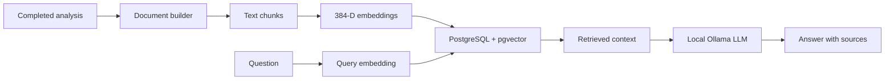

# Phase 08  Local RAG assistant

## Objective

Add a read-only assistant that answers questions using indexed football-analysis
results. Keep inference local with pgvector, sentence-transformers, and Ollama.

## Starting state

The API already produced structured video-analysis summaries and MLflow runs.
It had no semantic index or grounded question-answering interface.

## Architecture

## What was implemented

- A pgvector schema with documents, chunks, HNSW cosine index, and job/MLflow
  provenance.
- Analysis-to-document conversion, 384-dimensional normalized embeddings,
  idempotent document upsert, semantic search, and Ollama generation.
- `GET /rag/status` and `POST /rag/ask`, with retrieved sources in answers.
- Optional automatic indexing after a completed video job, controlled by
  `FOOTBALLMATCH_RAG_AUTO_INDEX`. An indexing failure does not mark the
  video analysis as failed.
- Prometheus counters and latency histograms for RAG requests, errors,
  retrieval, generation, and total duration.
- A KFP v2 pipeline definition and compiled YAML for orchestration study.
  A full Kubeflow installation is not part of this local VM deployment.

## Files added or modified

See `src/footballmatch_api/rag/`, `sql/rag_schema.sql`,
`scripts/{ask_rag,index_rag_document,search_rag,build_rag_document}.py`,
`pipelines/`, `tests/test_rag_*.py`, `pyproject.toml`,
`compose.yaml`, and this documentation.

## Commands executed

| Command | Purpose | Important flags | Expected result |
| --- | --- | --- | --- |
| `docker compose config` | Validate Compose syntax | None | Resolved services |
| `python -m ruff check .` | Lint source | Module invocation | All checks passed |
| `python -m pytest -q` | Run automated tests | Quiet output | Passing suite |
| `python scripts/index_rag_document.py FILE.json` | Index one result | Input file | Document and chunk IDs |
| `python scripts/ask_rag.py "QUESTION"` | Ask local RAG | Question text | Answer and sources |

The database password comes from the environment or a local untracked
`.env`; it is never recorded in a command or committed.

## Validation

The RAG API, document builder, repository helpers, and automatic indexer have
automated tests. The feature branch is also exercised by the CI test, lint,
secret-scan, SAST, and filesystem-scan jobs. Kubernetes-to-PostgreSQL
connectivity and `POST /rag/ask` from a K3s Pod remain a separate deployment
validation step.

## Tests executed

CI on the descendant Kubernetes branch passed 44 tests and Ruff. The RAG
tests use controlled dependencies for unit behavior; they do not prove
PostgreSQL and Ollama are reachable from K3s.

## Evidence

- The schema declares `vector(384)` and an HNSW cosine index.
- The API returns source text and similarity with a generated answer.
- The feature flag defaults to off, so core video analysis remains usable
  without RAG dependencies.

## Errors encountered

No cluster networking error is claimed resolved by this implementation.
PostgreSQL is private to the Docker Compose network in the current topology.

## Root causes

Docker Compose DNS names are not Kubernetes DNS names. A K3s Pod therefore
needs an explicit secured path to PostgreSQL and Ollama.

## Fixes

The next block will configure external-service connectivity through Helm
values, ConfigMap, and a Kubernetes Secret, then validate RAG from the Pod.

## Security considerations

The assistant is read-only. SQL uses parameterized values. Database passwords
must be provided outside Git. Retrieved text is untrusted input to the LLM;
the prompt asks the model to use only supplied context, but application
validation must still check answers and source references.

## DevOps / MLOps best practices applied

Separate embedding, persistence, retrieval, and generation components;
retain job and MLflow provenance; record RAG metrics; make indexing optional
and best-effort; keep model and database configuration external.

## Git / PR summary

This phase is developed on `feat/rag-platform` and should be merged into
`main` before the dependent Kubernetes PR is retargeted to `main`.

## Limitations

The local model can hallucinate despite grounding instructions. Search
quality depends on document construction and the small embedding model.
A full Kubeflow control plane is not installed. The K3s Pod has not yet
reached PostgreSQL/pgvector for RAG calls.

## Next phase

Validate PostgreSQL and Ollama connectivity from K3s, index a real analysis,
ask a grounded question through the Pod, and handle network errors clearly.

## How I would explain this phase in an interview

"I turned video-analysis summaries into retrievable documents. A local
embedding model stores 384-dimensional vectors in PostgreSQL with pgvector.
At query time I retrieve relevant chunks and pass them to a local Ollama
model, returning the answer with its sources. I keep indexing optional so
a RAG outage cannot break video analysis."
