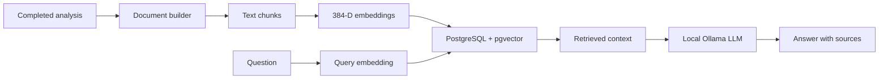

# Phase 08  Local RAG assistant

## Objective

Add a read-only assistant that answers questions using indexed football-analysis
results. Keep inference local with pgvector, sentence-transformers, and Ollama.

## Starting state

The API already produced structured video-analysis summaries and MLflow runs.
It had no semantic index or grounded question-answering interface.

## Architecture

## What was implemented

- A pgvector schema with documents, chunks, HNSW cosine index, and job/MLflow
  provenance.
- Analysis-to-document conversion, 384-dimensional normalized embeddings,
  idempotent document upsert, semantic search, and Ollama generation.
- `GET /rag/status` and `POST /rag/ask`, with retrieved sources in answers.
- Optional automatic indexing after a completed video job, controlled by
  `FOOTBALLMATCH_RAG_AUTO_INDEX`. An indexing failure does not mark the
  video analysis as failed.
- Prometheus counters and latency histograms for RAG requests, errors,
  retrieval, generation, and total duration.
- A KFP v2 pipeline definition and compiled YAML for orchestration study.
  A full Kubeflow installation is not part of this local VM deployment.

## Files added or modified

See `src/footballmatch_api/rag/`, `sql/rag_schema.sql`,
`scripts/{ask_rag,index_rag_document,search_rag,build_rag_document}.py`,
`pipelines/`, `tests/test_rag_*.py`, `pyproject.toml`,
`compose.yaml`, and this documentation.

## Commands executed

| Command | Purpose | Important flags | Expected result |
| --- | --- | --- | --- |
| `docker compose config` | Validate Compose syntax | None | Resolved services |
| `python -m ruff check .` | Lint source | Module invocation | All checks passed |
| `python -m pytest -q` | Run automated tests | Quiet output | Passing suite |
| `python scripts/index_rag_document.py FILE.json` | Index one result | Input file | Document and chunk IDs |
| `python scripts/ask_rag.py "QUESTION"` | Ask local RAG | Question text | Answer and sources |

The database password comes from the environment or a local untracked
`.env`; it is never recorded in a command or committed.

## Validation

The RAG API, document builder, repository helpers, and automatic indexer have
automated tests. The feature branch is also exercised by the CI test, lint,
secret-scan, SAST, and filesystem-scan jobs. Kubernetes-to-PostgreSQL connectivity and `POST /rag/ask` were later
validated from the K3s Pod as described below.

## Tests executed

CI on the descendant Kubernetes branch passed 44 tests and Ruff. The RAG
tests use controlled dependencies for unit behavior; they do not prove
PostgreSQL and Ollama are reachable from K3s.

## Evidence

- The schema declares `vector(384)` and an HNSW cosine index.
- The API returns source text and similarity with a generated answer.
- The feature flag defaults to off, so core video analysis remains usable
  without RAG dependencies.

## Errors encountered

Initially PostgreSQL was private to the Docker Compose network, so a
K3s Pod could not reach its container-only address.

## Root causes

Docker Compose DNS names are not Kubernetes DNS names. The Pod needed a
host-reachable PostgreSQL listener and explicit addresses for external services.

## Fixes

Compose now publishes PostgreSQL on a configurable host address and port
(default loopback only). On this VM, the ignored local `.env` binds it to
the Docker host bridge. Helm ConfigMap values point the Pod to that listener
and to Ollama; a Kubernetes Secret supplies the database password.

## Security considerations

The assistant is read-only. SQL uses parameterized values. Database passwords
must be provided outside Git. Retrieved text is untrusted input to the LLM;
the prompt asks the model to use only supplied context, but application
validation must still check answers and source references.

## DevOps / MLOps best practices applied

Separate embedding, persistence, retrieval, and generation components;
retain job and MLflow provenance; record RAG metrics; make indexing optional
and best-effort; keep model and database configuration external.

## Git / PR summary

The RAG parent was squash-merged in PR #18. The Kubernetes branch was
rebased without duplicate RAG commits and squash-merged in PR #17.

## Limitations

The local model can hallucinate despite grounding instructions. Search
quality depends on document construction and the small embedding model.
A full Kubeflow control plane is not installed. The local RAG proof uses
one indexed analysis and a small CPU model; answer quality is not benchmarked.

## Next phase

Add lightweight Prometheus and Grafana deployment with persistent data on
`/data`, then validate metrics from a real API request.

## How I would explain this phase in an interview

"I turned video-analysis summaries into retrievable documents. A local
embedding model stores 384-dimensional vectors in PostgreSQL with pgvector.
At query time I retrieve relevant chunks and pass them to a local Ollama
model, returning the answer with its sources. I keep indexing optional so
a RAG outage cannot break video analysis."

## Kubernetes connectivity validation (2026-10-28)

- PostgreSQL/pgvector remains in Compose; MLflow remains in Compose; Ollama
  remains on the VM. The API runs in K3s. No database migration was needed.
- A compressed `pg_dumpall` backup was taken before recreating PostgreSQL
  with the additional host-bridge listener. The same Compose volume retained
  the five indexed RAG chunks.
- The database password was streamed from local Compose configuration into
  `footballmatch-rag-db`, a Kubernetes Secret. Neither its value nor the
  VM-specific bridge address is committed.
- The Pod queried `rag_chunks` successfully (count: 5). It reached the
  PostgreSQL listener, MLflow, and Ollama over the host bridge.
- `GET /rag/status` from the Pod returned HTTP 200. A real `POST /rag/ask`
  from the Pod asked how many frames job
  `1302e0b0-0a22-452f-b43a-da0ca3409773` processed. It returned HTTP 200,
  answer `73`, model `gemma3:1b`, and three source passages including
  `Frames processed: 73`.
- The endpoint maps PostgreSQL connection failures to a safe HTTP 503;
  the repository sets a five-second connection timeout. Unit tests cover
  the response without printing host or password details.

### Commands and expected output

| Command | Purpose | Important flags | Expected output |
| --- | --- | --- | --- |
| `docker compose config --quiet` | Validate local Compose configuration | `--quiet` avoids printing resolved secrets | Exit 0 |
| `docker compose up -d --no-deps postgres` | Apply only the PostgreSQL listener change | `--no-deps` leaves the other services alone | PostgreSQL healthy |
| `kubectl get pods -n footballmatch` | Check the deployed API | Namespace flag | One API Pod, `1/1 Running` |
| `kubectl exec -n footballmatch deployment/footballmatch-footballmatch-ai-platform -- python ...` | Test from the Pod network | `exec` runs inside the container | RAG chunks: 5; endpoints: HTTP 200 |
| `helm lint helm/footballmatch-ai-platform` | Validate chart structure | Chart path | Zero chart failures |
| `helm template footballmatch helm/footballmatch-ai-platform -n footballmatch` | Render manifests without applying | Namespace flag | Deployment and ConfigMap |

The current proof uses a single-node host bridge. For multi-node Kubernetes,
use a stable service address, network policy, and proper secret management.
Do not use a Pod or Docker container IP as a durable endpoint.
